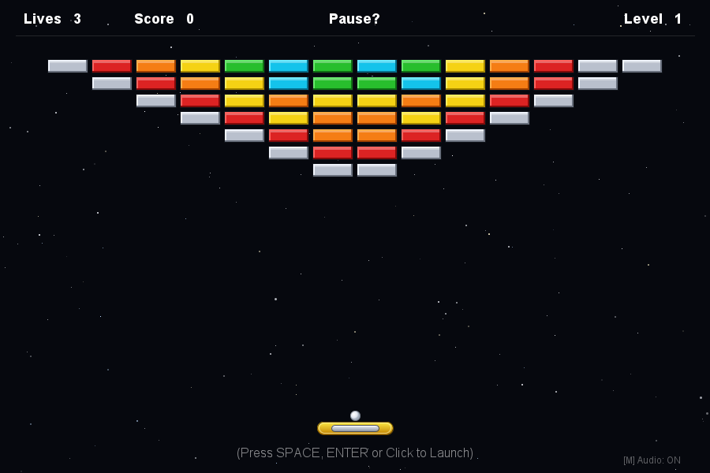
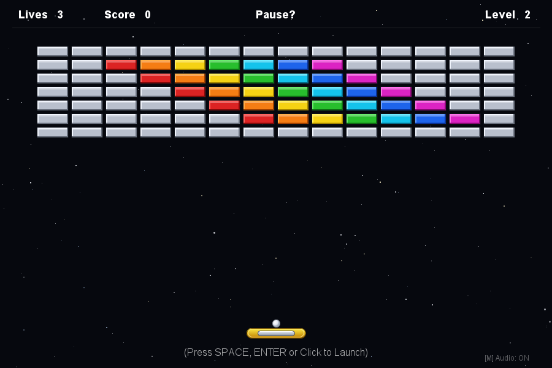
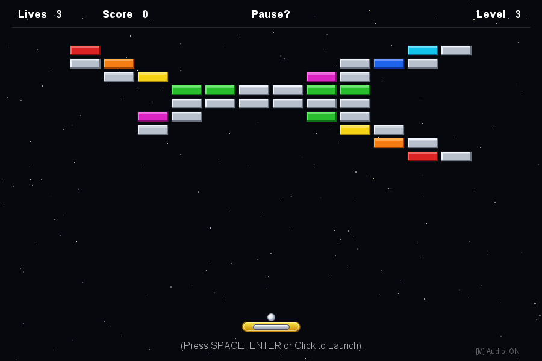
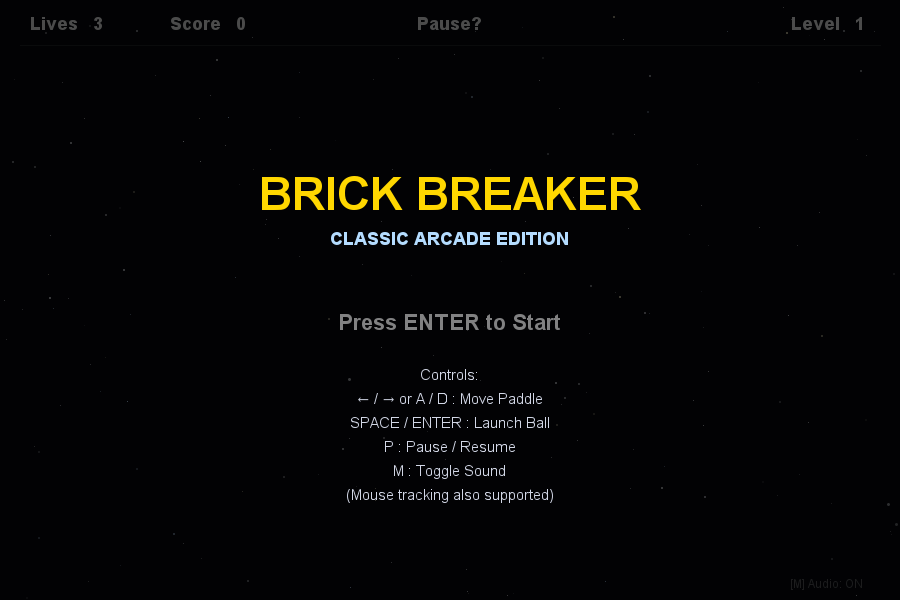

# Brick Breaker - Classic Arcade (Java Swing / AWT)

A complete, fully functional 2D retro Brick Breaker / Breakout arcade game written purely in standard Java (Swing & Java2D). Built with zero external dependencies, running smoothly at 60 FPS with authentic arcade physics, 10 handcrafted level layouts matching classic retro references, synthesized 8-bit sound effects, and infinite procedural endgame progression.

---

## Game Highlights & Visual Fidelity

- **Faithful Retro Aesthetics**: Deep space starry background with procedural sparkling stars, crisp arcade typography, 3D-beveled bricks with specular gloss highlights, golden capsule paddle with a metallic silver inset, and a shaded 3D spherical ball.
- **Realistic 2D Collision Physics**: Multi-step collision resolution preventing ball tunneling or sticking, with paddle angle deflection based on point-of-impact (up to 60°) and minimum vertical velocity enforcement to prevent flat bouncing loops.
- **Multi-Hit Metallic Bricks**: Silver bricks require 2 hits and display a retro red damage crack emblem on first impact.
- **10 Unique Level Layouts + Endless Mode**:
  1. *The Wing / Inverted Pyramid* (Reference 1)
  2. *The Fortress with Diagonal Rainbow* (Reference 3)
  3. *The Butterfly / X-Wing* (Reference 2)
  4. *The Diamond Shield*
  5. *Twin Castles with Suspension Bridge*
  6. *Interlocking Staircase*
  7. *Space Invader / Alien Boss*
  8. *Concentric Shields / Bullseye*
  9. *Dual Cosmic Sine Wave*
  10. *The Champion's Crown*
  11. *Endless Mode (Levels 11+)*: Procedurally generated symmetrical arcade patterns with progressive difficulty.
- **Pure Java Synthesized Audio**: Built-in 8-bit retro sound synthesizer powered by `javax.sound.sampled` (paddle hits, brick impacts, wall bounces, life loss slide tones, and victory arpeggios). Works out of the box with zero sound files and fails gracefully if no audio hardware is present.

---

## Project Structure

```
Java/Brick-Game/
 ├── src/
 │    ├── Main.java               # Application entry point & JFrame window
 │    ├── App.java                # VS Code entry point delegating to Main
 │    ├── GamePanel.java          # 60 FPS game loop, physics sub-stepping & HUD overlays
 │    ├── GameState.java          # State machine (START, BALL_READY, PLAYING, etc.)
 │    ├── Paddle.java             # Golden capsule paddle with boundary clamping
 │    ├── Ball.java               # 2D vector ball physics & angle reflection
 │    ├── Brick.java              # 3D beveled brick with hit point management
 │    ├── BrickColor.java         # Palettes, scores, and hit point configurations
 │    ├── LevelManager.java       # 10 level layouts + procedural generator
 │    ├── Star.java               # Twinkling star particle
 │    ├── StarField.java          # Procedural starry background
 │    ├── InputHandler.java       # Keyboard and mouse listener adapter
 │    ├── SoundManager.java       # Pure Java synthesized 8-bit sound effects (polyphonic Clips)
 │    └── GameMechanicsTest.java  # Comprehensive automated mechanics test suite
 ├── screenshots/                 # High-resolution rendered preview images
 ├── .gitignore                   # Ignores bin/ and IDE caches
 └── README.md                    # Project documentation & customization guide
```

---

## 📸 Gameplay Previews

| Level 1: The Wing (Ref. 1) | Level 2: Fortress Rainbow (Ref. 3) |
| :---: | :---: |
|  |  |

| Level 3: Butterfly X-Wing (Ref. 2) | Title / Start Screen |
| :---: | :---: |
|  |  |

---

## How to Compile and Run

### Prerequisites
- Java Development Kit (JDK 8 or later). Verified and tested with Java 21 / 27.
- Works on Windows, macOS, and Linux.

### 1. Compile from Terminal
Open PowerShell or your terminal in `Java/Brick-Game`:

```powershell
# Create bin directory if it doesn't exist
mkdir bin -Force

# Compile all source files into bin/
javac -d bin src/*.java
```

### 2. Run the Game
```powershell
java -cp bin Main
```
*(Or use `java -cp bin App`)*

### 3. Run Automated Mechanics Verification Test
```powershell
java -cp bin GameMechanicsTest
```

---

## Controls

| Key / Input | Action |
| :--- | :--- |
| **LEFT ARROW** / **A** | Move paddle left smoothly |
| **RIGHT ARROW** / **D** | Move paddle right smoothly |
| **SPACE** / **ENTER** | Launch ball / Start game / Unpause / Restart |
| **P** | Pause / Resume gameplay |
| **M** | Toggle Sound (Mute / Unmute) |
| **ESC** | Pause game / Return to title screen |
| **Mouse Move** | Fluid mouse tracking for paddle |
| **Mouse Click** | Launch ball / Start / Unpause |

---

## Customization Guide

All game constants are cleanly organized in specific classes:

### 1. Paddle Size & Speed
Open `src/Paddle.java`:
- **Paddle dimensions**:
  ```java
  this.width = 96;   // Change paddle width (e.g. 80 - 120)
  this.height = 16;  // Change paddle height
  ```
- **Paddle speed**:
  ```java
  this.speed = 7.5;  // Pixels moved per frame
  ```

### 2. Ball Speed & Progression
Open `src/LevelManager.java`:
- **Speed formula per level**:
  ```java
  public double getBallSpeedForLevel(int level) {
      double speed = 4.2 + (level - 1) * 0.22; // Base speed & scale
      return Math.min(speed, 6.8);             // Maximum speed cap
  }
  ```

### 3. Ball Size & Minimum Vertical Velocity
Open `src/Ball.java`:
- **Ball diameter**:
  ```java
  this.diameter = 13; // Radius ~6.5px
  ```
- **Anti-stick minimum vertical velocity**:
  ```java
  double minVy = 2.2; // Increase to force more vertical bounces
  ```

### 4. Player Lives & Score Values
- **Initial Lives**: In `src/GamePanel.java`:
  ```java
  private int lives = 3; // Change starting lives
  ```
- **Brick Scores & Colors**: In `src/BrickColor.java`:
  ```java
  RED(..., points: 10, hits: 1),
  SILVER(..., points: 50, hits: 2), // 2 hits for metallic bricks
  GOLD(..., points: 100, hits: 2)
  ```

### 5. Level Layouts & Adding New Levels
Open `src/LevelManager.java`:
- Change or add patterns in `loadLevel(int level)`.
- Use grid helpers: `getCellX(col)` and `getCellY(row)` with `BrickColor.*`.

### 6. Screen Size & Window Geometry
Open `src/GamePanel.java`:
```java
public static final int PANEL_WIDTH = 900;
public static final int PANEL_HEIGHT = 600;
public static final int HUD_HEIGHT = 45;
```
