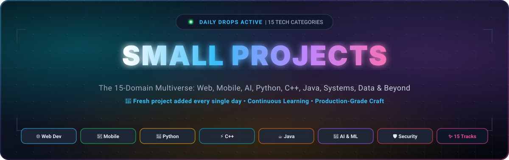

<p align="center">
  
</p>

<p align="center">
  <strong>🚀 Daily bite-sized projects across 15 core technology domains!</strong><br>
  <em>Because mastery isn't built overnight—it's forged one small project every single day.</em>
</p>

<p align="center">
  <a href="https://github.com/Raj-AI-Tech/Small-Projects/stargazers"></a>
  <a href="https://github.com/Raj-AI-Tech/Small-Projects/network/members"></a>
  <a href="#-the-15-core-tech-domains"></a>
  <a href="#-the-15-core-tech-domains"></a>
  <a href="LICENSE"></a>
  <a href="#-contributing"></a>
</p>

<p align="center">
  <a href="#-about-the-repository">🌟 About</a> •
  <a href="#-why-small-projects">💡 Philosophy</a> •
  <a href="#-the-15-core-tech-domains">🗂️ 15 Domains</a> •
  <a href="#-how-to-run-any-project">💻 Quick Start</a> •
  <a href="#-the-tech-arsenal">🛠️ Tech Arsenal</a> •
  <a href="#-contributing">🤝 Contribute</a>
</p>

---

## 🌟 About The Repository

Welcome to **Small Projects** — your comprehensive daily sandbox spanning the entire landscape of modern computer science and software engineering!

Too many developers get stuck in tutorial hell or overwhelmed by massive, monolithic architectures. Here, we believe in **high-velocity, atomic learning**:
* 📅 **Fresh Projects Added Daily**: New mini-projects get committed regularly so you never run out of inspiration or stop learning.
* 🏛️ **15 Distinct Disciplines**: From low-level Systems and Embedded IoT to Web3, Cloud, AI, and Creative Coding—every corner of tech is explored.
* ⚡ **Production-Grade Craftsmanship**: Every micro-project adheres to clean design, sensible architecture, semantic code, and zero bloat.
* 🎓 **Self-Contained & Modular**: Clone, run, inspect, and learn in under 10 minutes.

---

## 💡 Why Small Projects?

> *"Compounding 1% improvement every day makes you 37x better in a year."*

| ❌ Big Monolithic Tutorials | ✅ Small Daily Projects |
| :--- | :--- |
| Weeks spent wrestling with bulky boilerplate | Instant gratification: Clone, run, and grasp concepts fast |
| High cognitive fatigue & tutorial paralysis | Focused mastery of one specific API, pattern, or algorithm |
| Locked into a single stack or language | Polyglot agility: Seamlessly switch across 15 domains |
| Obscure bugs buried in 10,000 files | Pristine, readable, well-commented source code |

---

## 🗂️ The 15 Core Tech Domains

Explore our complete curriculum across all 15 software engineering disciplines. Click any domain to jump straight to its details:

| # | Domain | Core Focus | Key Technologies | Quick Jump |
|:---:|:---|:---|:---|:---:|
| **01** | 🌐 **Web Development** | Browser apps, front-end, back-end & full-stack | `JavaScript` `React` `Node.js` `Python` `HTML/CSS` | [Explore ↓](#01--web-development) |
| **02** | 📱 **Mobile App Development** | Native iOS/Android & cross-platform mobile apps | `Swift` `Kotlin` `Java` `Flutter` `React Native` | [Explore ↓](#02--mobile-app-development) |
| **03** | 🧠 **AI & Machine Learning** | Pattern recognition, deep neural nets & NLP | `Python` `PyTorch` `TensorFlow` `scikit-learn` `C++` | [Explore ↓](#03--artificial-intelligence-ai--machine-learning-ml) |
| **04** | 📊 **Data Science & Big Data** | Actionable insights, data lakes & ETL pipelines | `Python` `R` `SQL` `Apache Spark` `Hadoop` | [Explore ↓](#04--data-science--big-data-engineering) |
| **05** | 🛡️ **Cybersecurity & Ethical Hacking** | Securing assets, pentesting & custom security tools | `Python` `Bash` `C` `PowerShell` `Linux` `Wireshark` | [Explore ↓](#05--cybersecurity--ethical-hacking) |
| **06** | ☁️ **Cloud Computing & Infra** | Serverless apps, remote networks & managed clouds | `AWS` `Azure` `Google Cloud (GCP)` | [Explore ↓](#06--cloud-computing--infrastructure) |
| **07** | ⚙️ **DevOps & SRE** | Deployment automation, CI/CD & infrastructure-as-code | `Docker` `Kubernetes` `Jenkins` `Terraform` `GitHub Actions` | [Explore ↓](#07--devops--site-reliability-engineering-sre) |
| **08** | 🎮 **Game Development** | Physics engines, game logic & 2D/3D graphics | `C++` `C#` `Unity` `Unreal Engine` `Godot` | [Explore ↓](#08--game-development) |
| **09** | ⚡ **Systems Programming** | Low-level hardware interfaces, OS & compilers | `C` `C++` `Rust` `Assembly` | [Explore ↓](#09--systems-programming) |
| **10** | 🤖 **Embedded Systems & IoT** | Microcontrollers, robotics & hardware sensors | `C` `C++` `MicroPython` `Arduino` `Raspberry Pi` | [Explore ↓](#10--embedded-systems--internet-of-things-iot) |
| **11** | 🗄️ **Database Engineering (DBMS)** | Relational schemas, NoSQL stores & fast caches | `PostgreSQL` `MySQL` `MongoDB` `Redis` `Oracle` | [Explore ↓](#11--database-administration--engineering-dbms) |
| **12** | ⛓️ **Blockchain & Web3** | Decentralized dApps, smart contracts & DeFi | `Solidity` `Rust` `Go` `Ethereum` `Web3.js` | [Explore ↓](#12--blockchain--web3-development) |
| **13** | 🧪 **QA & Test Automation** | Automated bug sweeps, E2E testing & load runs | `Python` `Playwright` `Cypress` `Selenium` `JUnit` | [Explore ↓](#13--quality-assurance-qa--test-automation) |
| **14** | 🏢 **Enterprise Software** | Large-scale CRM/ERP, business logic & microservices | `Java` `C# (.NET)` `SAP` `Salesforce (Apex)` | [Explore ↓](#14--enterprise-software-engineering) |
| **15** | 🎨 **UI/UX & Creative Coding** | Interactive art, shaders, 3D math & animations | `JavaScript` `Three.js` `D3.js` `Processing` `CSS/Canvas` | [Explore ↓](#15--uiux--creative-coding) |

---

### 01. 🌐 Web Development
* **Focus**: Creating websites, web applications, and services that run inside a web browser.
* **Core Domains**: Front-End (user interface), Back-End (servers and databases), and Full-Stack (both sides).
* **Key Tech**: `JavaScript` `Python` `Java` `React` `Node.js` `HTML/CSS`
* **Concepts & Project Types**:
  * [**Retro-Calculator**](./Web%20Development/Retro-Calculator) — Dieter Rams vintage physical calculator with synthesized Web Audio clicks & LCD panel.
  * **Glassmorphic Kanban Board** — Drag-and-drop task workflow with persistent local storage.
  * **Dynamic Weather Particles** — Real-time atmospheric canvas engine using OpenWeather API.

---

### 02. 📱 Mobile App Development
* **Focus**: Developing software optimized for smartphones, tablets, and wearable tech.
* **Core Domains**: Native iOS development, Native Android development, and Cross-Platform (one codebase for both).
* **Key Tech**: `Swift` `Kotlin` `Java` `Flutter (Dart)` `React Native`
* **Concepts & Project Types**:
  * **Minimal Habit Streak** — Fluid micro-animated daily counter built with Jetpack Compose.
  * **Pedometer & Step Monitor** — Hardware sensor listener tracking daily steps and cadence.
  * **Biometric Secret Note Vault** — Fingerprint/FaceID authenticated secure scratchpad.

---

### 03. 🧠 Artificial Intelligence (AI) & Machine Learning (ML)
* **Focus**: Building systems that learn from data, recognize patterns, and make automated decisions.
* **Core Domains**: Deep Learning (neural networks), Natural Language Processing (NLP), and Computer Vision.
* **Key Tech**: `Python` `C++` `PyTorch` `TensorFlow` `scikit-learn`
* **Concepts & Project Types**:
  * **Edge Motion Sentry** — Lightweight OpenCV webcam motion tracker with sound alert.
  * **Micro-RAG PDF Assistant** — Local vector search and embeddings to chat with documents.
  * **From-Scratch Perceptron** — Pure Python matrix math implementation of neural backprop.

---

### 04. 📊 Data Science & Big Data Engineering
* **Focus**: Extracting actionable insights from massive, complex datasets and building pipelines to move that data.
* **Core Domains**: Data analysis, predictive modeling, data warehousing, and ETL (Extract, Transform, Load) pipelines.
* **Key Tech**: `Python` `R` `SQL` `Apache Spark` `Hadoop`
* **Concepts & Project Types**:
  * **Streaming Log Aggregator** — Real-time Apache Spark pipeline filtering high-velocity server logs.
  * **Automated Data Cleaner & Imputer** — Python script auto-detecting outliers, null values, and skew.
  * **Crypto Volatility Visualizer** — Interactive Pandas & Plotly statistical correlation matrix.

---

### 05. 🛡️ Cybersecurity & Ethical Hacking
* **Focus**: Protecting digital assets, finding vulnerabilities, and writing secure software to prevent attacks.
* **Core Domains**: Penetration testing, cryptography, incident response, and writing automated security tools.
* **Key Tech**: `Python` `Bash` `C` `PowerShell` `Linux` `Wireshark`
* **Concepts & Project Types**:
  * **Async Port Scanner** — High-speed multi-threaded TCP banner grabber and service fingerprinting.
  * **Toy RSA Cryptosystem** — Step-by-step key generation, prime math, and message encryption.
  * **Malicious Traffic Sniffer** — Python Scapy utility alerting on ARP spoofing attempts.

---

### 06. ☁️ Cloud Computing & Infrastructure
* **Focus**: Designing, deploying, and managing applications on remote server networks instead of local hardware.
* **Core Domains**: Cloud architecture, serverless computing, and managed cloud databases.
* **Key Tech**: `Amazon Web Services (AWS)` `Microsoft Azure` `Google Cloud Platform (GCP)`
* **Concepts & Project Types**:
  * **Serverless Image Resizer** — AWS Lambda event trigger generating multi-size thumbnails on S3 uploads.
  * **Cloud Latency Ping Daemon** — Global heartbeat benchmark testing multi-region ping times.
  * **Automated S3 Cold Archiver** — Lifecycle cron script migrating stale logs to Glacier tier.

---

### 07. ⚙️ DevOps & Site Reliability Engineering (SRE)
* **Focus**: Bridging the gap between software development and IT operations to automate software deployment.
* **Core Domains**: Continuous Integration/Continuous Deployment (CI/CD), infrastructure as code, and system monitoring.
* **Key Tech**: `Docker` `Kubernetes` `Jenkins` `Terraform` `GitHub Actions`
* **Concepts & Project Types**:
  * **Multi-Stage Docker Blueprint** — Ultra-slim production container reducing Node/Go image size by 90%.
  * **K8s Pod Self-Healing Demo** — Declarative deployment with liveness probes and rolling updates.
  * **GitHub Action Auto-Release** — Automated semantic versioning and changelog generator.

---

### 08. 🎮 Game Development
* **Focus**: Creating interactive video games, physics simulations, and virtual/augmented reality (VR/AR) experiences.
* **Core Domains**: Game logic, graphics programming, physics engines, and multiplayer networking.
* **Key Tech**: `C++` `C#` `Unity` `Unreal Engine` `Godot`
* **Concepts & Project Types**:
  * **Gravity Particle Sandbox** — 2D Verlet physics simulation handling 5,000 interacting particles.
  * **Terminal ASCII Rogue** — Procedural dungeon crawler with FOV raycasting in C++.
  * **Raylib Retro Space Blaster** — Vintage arcade shooter with screen shake and particle trails.

---

### 09. ⚡ Systems Programming
* **Focus**: Writing low-level software that provides services to other software and interacts closely with hardware.
* **Core Domains**: Operating systems (like Linux or Windows), device drivers, compilers, and file systems.
* **Key Tech**: `C` `C++` `Rust` `Assembly`
* **Concepts & Project Types**:
  * **Micro Unix Shell (`msh`)** — Custom command-line interpreter with piping (`|`), redirection (`>`), and signal traps.
  * **Block Memory Pool Allocator** — Cache-friendly fixed-size allocator outperforming default `malloc`.
  * **Virtual CPU & Bytecode VM** — Stack-based virtual machine executing custom assembly instructions.

---

### 10. 🤖 Embedded Systems & Internet of Things (IoT)
* **Focus**: Programming dedicated microcontrollers and hardware chips inside physical products.
* **Core Domains**: Smart appliances, automotive computers, robotics, medical devices, and wearables.
* **Key Tech**: `C` `C++` `MicroPython` `Arduino` `Raspberry Pi`
* **Concepts & Project Types**:
  * **OLED Real-Time Telemetry** — MicroPython driver rendering CPU temps and network graph on I2C display.
  * **Ultrasonic Autonomous Rover** — Collision avoidance logic for dual-motor Arduino car.
  * **ESP32 BLE Beacon Scanner** — Low-power Bluetooth detector tracking nearby devices and RSSI signals.

---

### 11. 🗄️ Database Administration & Engineering (DBMS)
* **Focus**: Designing, optimizing, and maintaining the systems that store and organize a company's data.
* **Core Domains**: Relational databases (structured data) and NoSQL databases (unstructured/flexible data).
* **Key Tech**: `PostgreSQL` `MySQL` `MongoDB` `Redis` `Oracle DB`
* **Concepts & Project Types**:
  * **In-Memory Key-Value Cache** — Minimal Redis clone implementing `GET`, `SET`, `TTL`, and LRU eviction in Python/Go.
  * **B-Tree Index Simulator** — Interactive visualization of node splitting, balancing, and logarithmic search.
  * **Query Cost Benchmark Suite** — Automated indexing comparator showcasing EXPLAIN ANALYZE speedups.

---

### 12. ⛓️ Blockchain & Web3 Development
* **Focus**: Building decentralized applications (dApps) and secure ledgers that operate without a central authority.
* **Core Domains**: Smart contracts, decentralized finance (DeFi), tokenomics, and cryptography.
* **Key Tech**: `Solidity` `Rust` `Go` `Ethereum` `Web3.js`
* **Concepts & Project Types**:
  * **ERC-20 Staking Vault** — Solidity smart contract rewarding token holders with dynamic APY.
  * **Merkle Airdrop Verifier** — Gas-optimized cryptographic proof verification on Ethereum.
  * **Minimal Local Blockchain** — Proof-of-Work ledger with SHA-256 block mining written in Python.

---

### 13. 🧪 Quality Assurance (QA) & Test Automation
* **Focus**: Writing code to automatically test software for bugs, performance issues, and user experience flaws.
* **Core Domains**: Unit testing, integration testing, end-to-end automation, and load testing.
* **Key Tech**: `Python` `Java` `Selenium` `Cypress` `Playwright` `JUnit`
* **Concepts & Project Types**:
  * **Playwright Visual Regression Suite** — Pixel-by-pixel automated snapshot tester catching CSS regressions.
  * **High-Concurrency API Stress Tester** — Locust-powered load generator measuring 99th percentile latencies.
  * **Fuzz Testing Engine** — Randomized payload injector fuzzing REST APIs to detect unhandled exceptions.

---

### 14. 🏢 Enterprise Software Engineering
* **Focus**: Developing massive, scalable, and highly secure software systems tailored for large corporations and governments.
* **Core Domains**: Customer Relationship Management (CRM), Enterprise Resource Planning (ERP), and internal business logic.
* **Key Tech**: `Java` `C# (.NET)` `SAP` `Salesforce (Apex)`
* **Concepts & Project Types**:
  * **Event-Driven Order Saga** — Decoupled event-sourced transaction pipeline using Outbox Pattern.
  * **Multi-Tenant Role-Based Access Control (RBAC)** — Granular hierarchical permission validator.
  * **Audit Trail Compliance Interceptor** — Spring Boot / .NET filter recording tamper-proof audit trails.

---

### 15. 🎨 UI/UX & Creative Coding
* **Focus**: Writing code where visual art, design, interactive installations, and human-computer interaction intersect.
* **Core Domains**: Generative art, complex web animations, data visualization, and interactive front-end design.
* **Key Tech**: `JavaScript` `Processing` `Three.js` `D3.js` `CSS/Canvas`
* **Concepts & Project Types**:
  * **Interactive 3D Stellar Galaxy** — WebGL shader simulation with orbiting celestial bodies in Three.js.
  * **Generative Perlin Flow Fields** — Dynamic vector field painting colorful organic ribbons on canvas.
  * **Hierarchical D3 Dependency Graph** — Zoomable, force-directed graph visualizing open-source ecosystems.

---

## 💻 How To Run Any Project

All projects are designed with zero friction and clear instructions.

### 🌐 For Web & Creative Projects
1. Navigate to the desired project directory:
   ```bash
   cd "Web Development/Retro-Calculator"
   ```
2. Open `index.html` directly in your browser, or launch a quick local server:
   ```bash
   npx serve .
   # or
   python -m http.server 8000
   ```

### 🐍 For Python, AI & Data Science Projects
1. Navigate to the project directory:
   ```bash
   cd "<Category-Name>/<Project-Name>"
   ```
2. Setup and run:
   ```bash
   python -m venv venv
   source venv/bin/activate  # On Windows: venv\Scripts\activate
   pip install -r requirements.txt
   python main.py
   ```

### ⚡ For C++, Systems & Game Projects
1. Navigate to the project directory:
   ```bash
   cd "<Category-Name>/<Project-Name>"
   ```
2. Compile and execute:
   ```bash
   g++ -std=c++20 -O3 main.cpp -o app
   ./app   # On Windows: .\app.exe
   ```

### 📱 For Mobile (Android / iOS / Flutter)
1. Open the project folder in **Android Studio** or **VS Code**.
2. Run `flutter pub get` or sync Gradle.
3. Click **Run** (`Shift + F10`) on your emulator or physical test device.

---

## 🛠️ The Tech Arsenal

Explore the diverse spectrum of technologies powering our daily drops:

<p align="center">
  
</p>

---

## 🤝 Contributing

Got an awesome micro-project idea in any of the 15 disciplines? Community contributions are enthusiastically welcomed!

1. **Fork** the repository.
2. **Create a branch** for your project:
   ```bash
   git checkout -b feature/your-project-name
   ```
3. **Add your project** inside the matching category folder:
   - Keep the code clean, modular, and self-contained.
   - Include a brief `README.md` inside your project directory detailing how to run it.
4. **Commit and Push**:
   ```bash
   git commit -m "feat(category): add your project name"
   git push origin feature/your-project-name
   ```
5. **Open a Pull Request**!

---

## 💬 Community & Feedback

- 🐛 **Found a bug?** Open an [Issue](https://github.com/Raj-AI-Tech/Small-Projects/issues).
- 💡 **Have a project idea for tomorrow's drop?** Suggest it in the discussions or open an issue labeled `daily-drop-idea`.
- ⭐ **Star this repo** to support daily development and never miss a drop!

---

<p align="center">
  <strong>Crafted with ❤️ and daily curiosity. Never stop learning!</strong><br>
  <sub>Licensed under the <a href="LICENSE">MIT License</a>. Open-source for all learners and builders.</sub>
</p>

<p align="center">
  <a href="#small-projects">▲ Back to Top</a>
</p>
